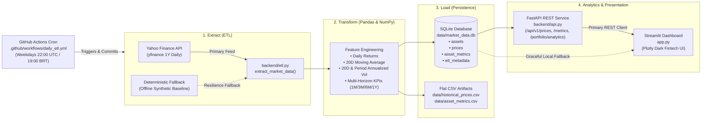

# B3 Market & Portfolio Pulse — Data Engineering & Analytics Platform

A production-style **Financial Data Engineering, REST API, and Portfolio Analytics Platform** built with **Python 3.11+**, **FastAPI**, **SQLite**, **Pandas**, **NumPy**, **yfinance**, and **Streamlit**.

Tracks core Brazilian B3 equities and real estate investment trusts (FIIs) — `PETR4.SA`, `VALE3.SA`, `ITUB4.SA`, `WEGE3.SA`, and `MXRF11.SA` — benchmarked against the **Ibovespa Index (`^BVSP`)** across multiple investment horizons (`1M`, `3M`, `6M`, `1Y`).

---

## Architecture Overview



### Multi-Tier Frontend Resilience
The Streamlit frontend (`app.py`) is decoupled from raw data ingestion and resolves market data in three resilient tiers:
1. **Tier 1 — FastAPI REST Service (`http://127.0.0.1:8000`)**: Requests historical price matrices (`GET /api/v1/prices`) and equal-weight portfolio simulations (`POST /api/v1/portfolio/analytics`) over HTTP.
2. **Tier 2 — Local SQLite & ETL Engine (`data/market_data.db`)**: If the FastAPI server is offline, `app.py` transparently queries `data/market_data.db` (auto-bootstrapping via `backend.etl` if empty) and computes portfolio metrics locally.
3. **Tier 3 — Calibrated Synthetic Baseline**: If upstream network access is unavailable during an initial run, the ETL pipeline synthesizes a deterministic 252-day geometric Brownian motion baseline so the platform never crashes.

---

## Project Directory Structure

```text
.
├── .github/
│   └── workflows/
│       └── daily_etl.yml        # Automated weekday ETL schedule (GitHub Actions)
├── backend/
│   ├── __init__.py              # Backend package export declarations
│   ├── database.py              # SQLite connection manager & normalized schema (assets, prices, asset_metrics)
│   ├── etl.py                   # Automated Extract (yfinance) -> Transform (Pandas) -> Load (SQLite + CSV)
│   └── api.py                   # FastAPI REST endpoints serving processed data & portfolio calculations
├── data/
│   ├── market_data.db           # Auto-generated SQLite relational database (via backend/etl.py)
│   ├── historical_prices.csv    # Normalized daily closing prices & rolling technical indicators
│   └── asset_metrics.csv        # Pre-aggregated multi-timeframe asset KPIs (1M, 3M, 6M, 1Y)
├── tests/
│   └── test_etl.py              # Pytest unit & integration tests for Pandas transforms, SQLite & FastAPI
├── app.py                       # Streamlit dashboard consuming FastAPI with graceful local SQLite fallback
├── requirements.txt             # Unified Python dependencies
└── README.md                    # Project architecture, schema, and operational documentation
```

---

## Normalized SQLite Database Schema (`data/market_data.db`)

Managed by `backend/database.py` with foreign key enforcement and Write-Ahead Logging (`WAL`):

| Table | Primary Key | Description | Key Columns |
| :--- | :--- | :--- | :--- |
| **`assets`** | `(ticker)` | Master catalog of tracked B3 equities, FIIs, and benchmark index | `ticker`, `asset_name`, `asset_type` (`EQUITY`, `FII`, `BENCHMARK`), `updated_at` |
| **`prices`** | `(date, ticker)` | Normalized daily time-series and rolling 20-day technical indicators | `date`, `ticker`, `close_price`, `daily_return`, `ma_20`, `volatility_20d`, `updated_at` |
| **`asset_metrics`** | `(ticker, timeframe)` | Pre-computed asset performance and risk KPIs across `1M`, `3M`, `6M`, `1Y` | `ticker`, `timeframe`, `asset_name`, `current_price`, `period_return_pct`, `ma_20`, `annualized_volatility_pct`, `min_price`, `max_price`, `observations` |
| **`etl_metadata`** | `(id = 1)` | Singleton audit record tracking the latest ETL run status | `last_run_at`, `source_label`, `is_fallback`, `row_count` |

---

## Financial & Quantitative Metrics

- **Base-100 Normalized Performance**:
  $$\text{Normalized}_{i,t} = 100 \times \frac{P_{i,t}}{P_{i,0}}, \quad \text{Portfolio}_t = \frac{1}{N}\sum_{i=1}^{N} \text{Normalized}_{i,t}$$
- **Alpha vs. Ibovespa (`^BVSP`)**:
  $$\alpha = R_{\text{portfolio}} - R_{\text{IBOV}}$$
- **20-Day Simple Moving Average (`MA20`)**:
  $$\text{MA20}_t = \frac{1}{20}\sum_{k=0}^{19} P_{t-k}$$
- **Annualized Volatility (252 B3 Trading Days)**:
  $$\sigma_{\text{annual}} = \sigma_{\text{daily}} \times \sqrt{252} \times 100$$

---

## Installation & Quick Start

### 1. Create Virtual Environment & Install Dependencies
```bash
python -m venv .venv
# Windows PowerShell:
.venv\Scripts\Activate.ps1
# Linux / macOS:
source .venv/bin/activate

pip install -r requirements.txt
```

### 2. Run the ETL Pipeline (Populates SQLite & CSVs)
```bash
# Live extraction from Yahoo Finance (with automatic fallback):
python -m backend.etl

# Deterministic offline mode:
python -m backend.etl --offline
```

### 3. Start the FastAPI Analytics Backend
```bash
uvicorn backend.api:app --host 127.0.0.1 --port 8000 --reload
```
- **Interactive Swagger UI:** `http://127.0.0.1:8000/docs`
- **OpenAPI Spec:** `http://127.0.0.1:8000/openapi.json`

### 4. Launch the Streamlit Frontend Dashboard
In a second terminal (or standalone — `app.py` automatically falls back to `data/market_data.db` if FastAPI is not running):
```bash
streamlit run app.py
```

### 5. Run Automated Unit & Integration Tests
```bash
pytest tests/ -v
```

---

## FastAPI REST API Reference

| Method | Endpoint | Description |
| :--- | :--- | :--- |
| `GET` | `/api/v1/health` | Service health check and latest SQLite `etl_metadata` audit status. |
| `GET` | `/api/v1/assets` | Catalog of tracked B3 tickers, default selection, `^BVSP` benchmark, and timeframes. |
| `GET` | `/api/v1/prices` | Historical 1-year daily closing price matrix (`?tickers=PETR4.SA,VALE3.SA,^BVSP`). |
| `GET` | `/api/v1/metrics` | Pre-computed SQLite asset KPIs filtered by timeframe (`?timeframe=1Y&tickers=PETR4.SA`). |
| `POST` | `/api/v1/portfolio/analytics` | Computes equal-weight portfolio curves, Alpha vs. `^BVSP`, volatility, and asset breakdown. |
| `GET` | `/api/v1/portfolio/analytics` | Query-parameter interface for equal-weight portfolio simulations (`?tickers=PETR4.SA,WEGE3.SA&timeframe=6M&initial_capital=10000`). |
| `POST` | `/api/v1/etl/refresh` | Triggers an on-demand ETL execution to refresh `data/market_data.db` and CSV exports. |

---

## Automated GitHub Actions Workflow

The workflow defined in [`.github/workflows/daily_etl.yml`](.github/workflows/daily_etl.yml) runs automatically every weekday at **22:00 UTC (19:00 BRT)** after the B3 market close:
1. Checks out the repository and sets up Python 3.11.
2. Installs dependencies from `requirements.txt`.
3. Runs `python -m backend.etl` to refresh `data/market_data.db`, `data/historical_prices.csv`, and `data/asset_metrics.csv`.
4. Executes `pytest tests/ -v` to validate data integrity and API contracts before committing.
5. Commits and pushes updated artifacts under `data/` back to the repository.
